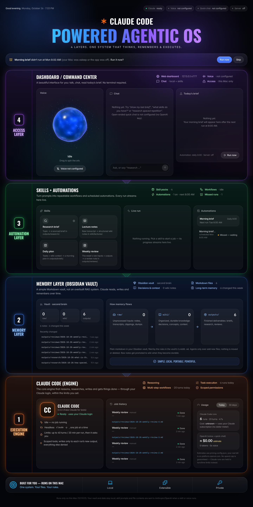
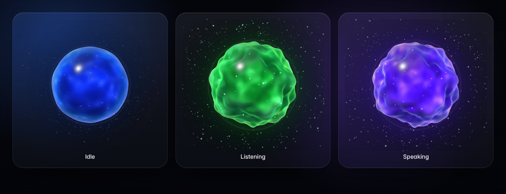

# Agentic OS

A personal, JARVIS-style assistant that runs **on your Mac**. It has a glass dashboard with a voice
orb, uses your Obsidian vault ("second brain") as memory, runs reusable **skills** (research briefs,
lecture notes, daily plans, weekly reviews) with Claude Code, and writes you a **morning brief at
8:00** every day.





> **Where it runs, and what leaves it**
>
> You can run Agentic OS in one of two places:
>
> - **On your own server** (`kiaan-cloud`). This is the recommended setup and is described just
>   below. It's private:
>   - only your devices signed in to Tailscale can reach it;
>   - nothing is open to the public internet;
>   - your vault syncs through **your private GitHub repo**.
> - **On your Mac only.** Sections 1–3. The app listens on `127.0.0.1`, so only that Mac can open
>   it.
>
> Either way, **the intelligence is not on your machine.** It comes from external AI services:
>
> - When a **skill** runs, Claude Code sends the prompt and the vault files it reads to **Anthropic**.
>   Research briefs also search and fetch web pages.
> - When you use **voice** or **quick chat**, your speech and messages go to **OpenAI**.
> - If you turn on the optional personal-server connector, the morning brief includes your calendar
>   and tasks in what it sends to Anthropic.
>
> This is how the app works and is expected.

---

## Run it on your server (kiaan-cloud), privately

**How it fits together:**

```
 Your Mac / iPhone ──(Tailscale: private, encrypted, HTTPS)──► kiaan-cloud :8443
                                                                   │  Tailscale Serve checks it's YOU
                                                                   ▼
                                                    Agentic OS on 127.0.0.1 (user "agentic",
                                                    systemd service, Claude Code inside)
                                                                   │  git pull / push
 Obsidian on your Mac ◄──(Obsidian Git plugin)──► private GitHub vault repo ◄──┘
```

You do this once. Each step says what you'll see.

### Step A: resize the server to 2 GB (about $12/month)

The server currently has 1 GB of memory, and your other services already use most of it.

1. Open DigitalOcean.
2. Go to **Droplets → kiaan-cloud → Resize**.
3. Choose **CPU and RAM only** (this keeps the disk the same size, so you can size down later).
4. Pick **2 GB / 1 CPU** and click **Resize**.

The server restarts, which takes about a minute. Your existing services come back on their own.

### Step B: put your vault on GitHub (private)

1. On github.com, click **New repository**.
   - Name: `second-brain`
   - Visibility: **Private**
   - Leave everything else empty.
2. Install **GitHub Desktop** (free) on your Mac and sign in.
3. **File → Add Local Repository →** choose your vault folder. When it offers to create a
   repository, click **create a repository**.
4. Click **Publish repository**, keep **Private** ticked, and choose the `second-brain` repo.
5. In Obsidian, open **Settings → Community plugins → Browse**, search **"Git"** (by Vinzent),
   then **Install** and **Enable**. In its settings:
   - set **Auto commit-and-sync interval** to 5 minutes;
   - set **Auto pull interval** to 5 minutes;
   - turn on **Pull on startup**.

Tip: in GitHub Desktop, right-click `.obsidian/workspace.json` → **Ignore file**. It changes constantly and would otherwise cause needless sync conflicts.

From then on, your Mac and the server share the same vault. New notes from Agentic OS show up in
Obsidian within a few minutes.

### Step C: Tailscale (private access)

1. Install **Tailscale** on your Mac (and iPhone if you like) from tailscale.com and sign in. It's
   free for personal use.
2. In the Tailscale admin console, go to **DNS** (login.tailscale.com/admin/dns) and turn **ON**:
   - **MagicDNS**
   - **HTTPS Certificates**

### Step D: run the setup script on the server

1. Download the setup script. On GitHub, open
   `kiaan990/kiaan99 → branch claude/vigilant-clarke-epb050 → agentic-os/deploy/setup-server.sh`,
   then click **Download raw file**. It goes to your Mac's Downloads folder.
2. In Mac Terminal, copy it to the server and run it:

   ```
   scp ~/Downloads/setup-server.sh root@142.93.127.49:/root/
   ssh -t root@142.93.127.49 'bash /root/setup-server.sh'
   ```

   `scp` copies the file to the server. `ssh -t` logs you in and runs it, interactively.

The script prints a ✓ for each finished step. It pauses whenever it needs you:

| It asks you to… | What to do |
|---|---|
| Add a **code key** | Copy the key it shows → GitHub `kiaan990/kiaan99` → **Settings → Deploy keys → Add**. Leave **write access off**. Press Return in Terminal. |
| Give the **vault repo** name | Type it, e.g. `kiaan990/second-brain`. |
| Add a **vault key** | Same as the code key, but on the `second-brain` repo, with **Allow write access ON**. Press Return. |
| Add the filing rules to `CLAUDE.md`? | `y`. It only appends; your existing text stays. |
| Log Claude Code in | It shows a link. Open it on your Mac, approve, and paste the code back. Copy the long token it prints (starts with `sk-ant-oat`) and paste it when asked. Your typing is hidden. |
| An OpenAI key | Paste it for voice and quick chat, or press Return to skip. |
| Your Tailscale login | The email or account you sign in to Tailscale with. **Only this account will be able to open the app.** |
| Log in to Tailscale (first time on the server) | Open the link on your Mac and sign in with the **same** account. |

It ends with:

```
Done.
  On your Mac (and iPhone): install Tailscale, sign in with the same account, then open:
      https://kiaan-cloud.<your-tailnet>.ts.net:8443
```

Bookmark that address. It's your dashboard, from anywhere, as long as Tailscale is on.

### Day to day on the server

- **It runs all the time**, so the 8:00 brief always happens. The missed-run banner should only
  appear after a server reboot or an update.
- **Status:** `ssh root@142.93.127.49 'systemctl status agentic-os'`
- **Live logs:** `ssh root@142.93.127.49 'journalctl -u agentic-os -f'` (press Control + C to stop
  watching)
- **Update to the newest code:**
  `ssh -t root@142.93.127.49 'bash /opt/agentic-os-src/agentic-os/deploy/update.sh'`
- **Vault sync problems** show as a **Vault sync: error** pill at the top of the dashboard. Hover
  over it for details.

### What's different about security on the server

- **Nothing is public.**
  - The app still listens only on `127.0.0.1` inside the server.
  - Tailscale Serve publishes it over HTTPS to **your tailnet only**.
  - No firewall ports are opened.
- **Only your Tailscale account gets in.** Every request, page and API alike, must carry your
  Tailscale identity, which Tailscale adds itself and can't be faked from outside. If
  `TAILSCALE_ALLOWED_USERS` is empty, the app **refuses to start**.
- **One limit:** other programs running on the server itself could talk to it directly. That's the
  same "other programs running as you" limit as on a Mac.
- **The local token** still guards against other websites in your browser.
- **A real boundary on the server.** The app runs as its own unprivileged Linux user (`agentic`)
  in a locked-down systemd service: read-only code, a 1.4 GB memory cap, no access to root's files
  or your other services. File access is therefore enforced by the operating system as well as by
  the app's own checks.
- **What it can reach on GitHub.** The server has two separate GitHub keys:
  - a **read-only** key for the code;
  - a write key **only for your vault repo**.

  The app commits only new files in `raw/`, `wiki/` and `outputs/`.
- **Claude Code** logs in with a subscription token from `claude setup-token`, stored in `.env`
  (readable only by the `agentic` user). There's no API key and no metered billing.

## Contents

1. [What you need](#1-what-you-need)
2. [Install (one time)](#2-install-one-time)
3. [Start and stop](#3-start-and-stop)
4. [What you'll see on first load](#4-what-youll-see-on-first-load)
5. [Everyday use](#5-everyday-use)
6. [Add a skill](#6-add-a-skill)
7. [Add or change an automation](#7-add-or-change-an-automation)
8. [When your Mac is asleep at 8:00](#8-when-your-mac-is-asleep-at-800)
9. [Costs: what can and can't be known](#9-costs-what-can-and-cant-be-known)
10. [Security: what's protected and what isn't](#10-security-whats-protected-and-what-isnt)
11. [Optional: connect your personal server (read-only)](#11-optional-connect-your-personal-server-read-only)
12. [Where things live](#12-where-things-live)
13. [Troubleshooting](#13-troubleshooting)
14. [Self-checks](#14-self-checks)

---

## On your Mac instead (sections 1–3)

Skip this part if you set it up on your server above.

## 1. What you need

| Thing | Why | Cost |
|---|---|---|
| A Mac | It runs here | — |
| **Node.js** (LTS) | Runs the app | Free |
| **Apple command line tools** (includes git) | Building one package | Free |
| **Claude Code**, logged in with your Claude account | Does the real work (skills) | Your existing Claude subscription. **No Anthropic API key needed.** |
| Your Obsidian vault "second brain" | Memory | — |
| *(Optional)* an **OpenAI API key** | Voice and quick chat | Pay-per-use on your OpenAI account. Skip it and those two features show "not configured"; everything else works. |

You don't need to install any of these by hand first. `install.sh` checks each one and tells you
the exact fix for anything that's missing.

## 2. Install (one time)

1. Open **Terminal**: press ⌘ + Space, type `Terminal`, press Return.
2. Go into this folder. Type `cd ` (with a space after it), drag the `agentic-os` folder from Finder
   into the Terminal window, then press Return.
3. Run:

   ```
   ./install.sh
   ```

**What it does, step by step.** It shows ✓ for every step that passes. If something's missing, it
stops and prints the exact fix.

| Step | What happens | You'll be asked |
|---|---|---|
| 1. Prerequisites | Checks Node.js, git, Claude Code, and that you're logged in to Claude Code | — |
| 2. Vault | Searches your home folder for "second brain" and lists what it finds. macOS may ask whether Terminal can look in Documents/Desktop; that's expected | Type the number of your vault, then `y` to confirm |
| 3. Vault folders | Creates `raw/`, `wiki/`, `outputs/` (and a few sub-folders) **only if missing** | — |
| 4. Filing rules | If your vault has a `CLAUDE.md`, it **adds** a section at the end and changes nothing above it. A backup goes to `agentic-os/backups/`. If there's no `CLAUDE.md`, it creates one | `y` / `n` |
| 5. Packages | Downloads the exact pinned versions into this folder and builds the dashboard (1–3 minutes) | — |
| 6. Settings | Creates `.env`, generates a random **local token**, saves the vault path | Paste an OpenAI key, or press Return to skip. Your typing is hidden |
| 7. Skills | Links the 4 skills into `~/.claude/skills/` so Claude Code can use them directly too | — |
| 8. Checks | Confirms Claude login, vault folders, and the OpenAI key (if given) | — |

At the end it prints **one start command**.

You can run `./install.sh` again any time, for example after adding an OpenAI key. It never
deletes anything.

## 3. Start and stop

**Start:**

```
cd /path/to/agentic-os && npm start
```

Expected output:

```
  Agentic OS is running (only on this Mac).
  Open:  http://127.0.0.1:4777
  Stop:  press Control + C in this window.
```

Open that address in Safari or Chrome. Keep the Terminal window open while you use the app.

**Stop:** click the Terminal window and press **Control + C**. Any running job is marked
"Interrupted". Your history is kept.

Automations only run while the app is running. If you want the 8:00 brief daily, leave it running,
for example in a Terminal window you minimize.

## 4. What you'll see on first load

The dashboard is built like a stack of four glowing layers, top to bottom, with a slowly moving
aurora behind them.

**Header.** A greeting with the date, four status pills on the right, and the title
**✳ CLAUDE CODE — POWERED AGENTIC OS** with the tagline *4 layers. One system that thinks,
remembers & executes.* The pills are:

- **Claude**: `ready`, `not logged in` or `not found`
- **Voice**: `on`, or `not configured` without an OpenAI key
- **Quick chat**: shows the model, or `not configured`
- **Server**: `off` unless you set up the optional connector

Each layer has its number and name on the left, a title, and a short list of live facts on the
right (for example "Skill packs · 4", "Markdown files · 0").

**④ Access layer (purple): Dashboard / Command Center**

- **Voice.** A 3D orb: a glossy, glowing ball inside a glass shell, with drifting particles. It
  breathes slowly in blue when idle, turns green and ripples with your voice while listening, and
  turns violet and pulses with the reply while speaking.
  - Move your mouse over it and it tilts toward you and bulges under the pointer.
  - Drag it to spin it.
  - Click it to start or stop voice.
  - On a computer without 3D graphics, a flat version is shown instead.
- **Chat.** "Nothing yet", with example things to type.
- **Today's brief.** "Nothing yet. Your morning brief will appear here after the next run at
  8:00 AM", with a **Run now** button.

**③ Automation layer (green): Skills + Automations**

- **Skills.** Four tiles (Research brief, Lecture notes, Daily plan, Weekly review). A small globe
  marks the one that uses the web.
- **Live run.** "Nothing running. Pick a skill to start a job."
- **Automations.** The morning brief ("Daily 8:00", next run time) and its run history.

**② Memory layer (blue): Obsidian vault**

- **Vault.** Note counts for `raw/`, `wiki/`, `outputs/`, plus recently changed files.
- **How memory flows.** `raw/` → `wiki/` → `outputs/` with live counts, ending in the line
  *Simple. Local. Portable. Powerful.*

**① Execution engine (orange): Claude Code**

- **Engine card.** Claude Code's version and login status, what's running, and the per-run limits.
- **Job history.** "Nothing yet".
- **Usage.** Claude runs (cost **unknown**, because they use your subscription) and OpenAI
  (**≈ $0.00 estimate**).

**Bottom strip.** *Built for you — runs on this Mac*, with Local · Extensible · Private.

The app shows no made-up data. Empty panels say "Nothing yet".

## 5. Everyday use

**Run a skill.** Click a tile, fill in the box (e.g. a topic), and press **Run**. The Live run panel
streams each step as it happens ("WebSearch …", "Write outputs/research/…"). When it finishes,
**Open** shows the result. Every result also has an **Obsidian** button that opens the note in
Obsidian.

**Chat.** Type in the Chat panel (Access layer). Requests are routed three ways:

| You type | What answers | Cost |
|---|---|---|
| "show my last brief", "job status", "what skills", "usage", "vault stats" | **Tier 1**: read straight from your files and database | Free, no AI call |
| An open question ("what's a good way to…") | **Tier 2**: a small, cheap OpenAI model, 3 sentences max | Small, shown as an estimate. Disabled without a key |
| "research *topic*", "plan my day", "weekly review" | **Tier 3**: proposes a skill job. **Nothing runs until you press Run** | Your Claude subscription |

The routing rules live in one file, `server/router.js`, which you can edit.

**Voice.** Click the orb (or **Start talking**) and allow the microphone.

- The orb turns **green** while it listens (it moves with your voice) and **violet** while it speaks.
- Answers are kept to a sentence or two. Long answers go to the Chat panel as text.
- A timer shows how long the session has run. It hangs up after 60 seconds of quiet and after
  15 minutes in total. You can change both in `.env`.

**Limits.** Every Claude run has a maximum number of turns and minutes, shown on each skill. If a
run reaches its limit, it **pauses and asks you** with two buttons: **Continue (+10 turns, 10 min)**
or **Stop**.

## 6. Add a skill

Skills are folders in `skills/`, each with a `SKILL.md`. There are two easy ways to make one: paste
a past conversation, or describe a recurring task in plain words. Both are explained in
**[skills/README.md](skills/README.md)**, along with the one extra step to give a new skill a
dashboard button.

## 7. Add or change an automation

Edit **`automations.config.json`** in any text editor. The app reloads it automatically within a
few seconds; there's no code to change. Example: add a weekly review every Sunday at 18:00:

```json
{
  "timezone": "local",
  "automations": [
    {
      "id": "morning-brief",
      "name": "Morning brief",
      "schedule": "0 8 * * *",
      "skillId": "daily-plan",
      "input": {},
      "enabled": true,
      "runOnCatchUp": "ask",
      "catchUpWindowHours": 16
    },
    {
      "id": "weekly-review",
      "name": "Sunday review",
      "schedule": "0 18 * * 0",
      "skillId": "weekly-review",
      "input": {},
      "enabled": true,
      "runOnCatchUp": false,
      "catchUpWindowHours": 24
    }
  ]
}
```

`schedule` uses cron format: **minute hour day-of-month month weekday**.

| You want | schedule |
|---|---|
| Every day 8:00 | `0 8 * * *` |
| Weekdays 7:30 | `30 7 * * 1-5` |
| Sundays 18:00 | `0 18 * * 0` |
| Every 2 hours | `0 */2 * * *` |

Rules:

- `skillId` must be one of the dashboard skills.
- `input` must match that skill's fields.
- If the file has a mistake, the dashboard shows the problem at the bottom and keeps using the last
  good version.

## 8. When your Mac is asleep at 8:00

A sleeping or switched-off Mac can't run anything, and neither can the app if it isn't running. To
make up for that:

- **Every time the app starts**, and every 5 minutes while it runs (which catches waking from
  sleep), it checks whether a scheduled run was missed.
- What happens next depends on each automation's `runOnCatchUp` setting:
  - `"ask"` (the default for the morning brief) shows a banner: *"Morning brief didn't run at 8:00
    (your Mac was asleep or the app was off). Run it now?"* with **Run now** / **Skip**.
  - `true` runs it automatically.
  - `false` records it as skipped.
- Only misses within `catchUpWindowHours` count (16 hours for the morning brief), so you won't be
  asked about last week's brief.
- Every run, missed, skipped or done, appears in **Run history → Automations**.

## 9. Costs: what can and can't be known

| | What the app shows | Why |
|---|---|---|
| **Claude Code runs** (skills, automations) | Runs, turns, minutes. **Cost: unknown** | They use your Claude login/subscription. There's no dollar meter to read, so the app doesn't invent one. |
| **OpenAI** (voice, quick chat) | Token counts and **≈ $ estimates, labelled "estimate"** | The app multiplies token counts by the prices in `pricing.config.json`. Your actual bill is on platform.openai.com. Update the prices if OpenAI changes them. |

What the app enforces:

- **Claude runs** have per-run limits (max turns, max minutes). When a run reaches one, it pauses
  and asks you before continuing. Caps are in `.env` (`CLAUDE_MAX_TURNS`, `CLAUDE_MAX_MINUTES`);
  each skill can be stricter.
- **Voice sessions** end after a quiet period and after a maximum length.
- **No exact spending cap is guaranteed.** These limits reduce usage; they can't promise a dollar
  figure.
- If `ANTHROPIC_API_KEY` is set in your shell, the app **ignores it** on purpose, so runs use your
  subscription instead of metered API billing.

## 10. Security: what's protected and what isn't

- **Only on this Mac.** The server listens on `127.0.0.1` only, never `0.0.0.0`. Other devices on
  your Wi-Fi can't reach it. There are no tunnels, no hosting and no cloud deploys.
- **Local token.** A random token is generated at install and stored in `.env`. Every API call must
  include it, and the API only accepts requests from the app's own page (`http://127.0.0.1:<port>`).
  - **What it protects against:** other **websites** you visit trying to call this local API
    through your browser.
  - **What it does not protect against:** other **programs** already running as you on your Mac.
    They can read `.env` like any of your files. No local web app can defend against that.
- **File access in the app.** Every path the app reads or writes is resolved to its real location
  and must be inside the project folder or the vault's `raw/`, `wiki/` or `outputs/`.
  - Paths that escape, and symlinks pointing outside, are **refused with an error**, and nothing is
    read or written.
  - The app only ever **creates new files**. It never overwrites, moves or deletes.
- **What Claude is allowed to do during a run.** Runs use Claude Code's own permission system in
  non-interactive mode (`claude -p`):
  - **Tools:** only the ones the skill lists. There's no Bash and no running code.
  - **Pre-approved:** reading in `raw/`, `wiki/` and `outputs/`, writing to this run's single new
    output file (or new folder), and web search/fetch for research.
  - **Everything else is denied** automatically (`--permission-mode dontAsk`). Nothing is
    auto-approved and no prompts are bypassed.
  - Your own MCP servers aren't loaded into these runs.
  - The run's working folder is a convenience for Claude, **not** a security boundary.
- **Review a skill's permissions.** Open any run in **Live run**: its first line, **Permissions**,
  lists the tools and the pre-approved write. The definitions are in `server/jobs/registry.js` (see
  [skills/README.md](skills/README.md#review-the-permissions-a-skill-needs)). Your personal
  `~/.claude/settings.json` still applies too, so check it if you've allowed extra tools there.
- **Only allowlisted skills can run.** The backend only starts jobs for skills in that registry,
  with fixed input fields. There is **no endpoint that runs arbitrary commands or arbitrary
  prompts**.
- **Secrets** live only in `.env`. They're never sent to the browser, printed, or written to logs.
  Voice uses a short-lived token from OpenAI; your real OpenAI key never leaves the server.
- **Your vault** is only ever added to, inside `raw/`, `wiki/` and `outputs/`. The only other
  change is the `CLAUDE.md` section you approved during install.

## 11. Optional: connect your personal server (read-only)

Off by default. To show your calendar and tasks in the morning brief, add your server's MCP
endpoint to `.env`:

```
MCP_SERVER_URL=https://your-server.example/mcp
MCP_AUTH_TOKEN=...            # if your server needs one
```

Restart the app.

- **Read-only is enforced.** Only read tools are called (`calendar_events`, `tasks_list`,
  `brief_list`, `brief_get`). Any tool whose name looks like a write (add/create/delete/update/…)
  is refused even if you list it. The app never writes to your server.
- If the server is unset or unreachable, everything else works and the pill says
  **Server: not connected**.

## 12. Where things live

```
agentic-os/
├─ install.sh                 one-time setup (safe to re-run)
├─ .env                       your settings + secrets (private, never committed)
├─ automations.config.json    your schedules
├─ pricing.config.json        OpenAI prices used for estimates
├─ skills/                    the skills (SKILL.md + template.md each)
├─ server/                    the backend (Express on 127.0.0.1)
│  ├─ jobs/registry.js        the skill allowlist
│  ├─ router.js               chat routing rules (Tier 1/2/3)
│  └─ test/                   automated acceptance checks
├─ web/                       the dashboard (Vite + React + Tailwind)
├─ data/agentic-os.db         jobs, run history, automation runs, usage (SQLite)
├─ logs/server.log            app log (secrets redacted)
└─ backups/                   copy of your vault CLAUDE.md before the rules were added
```

- **Backing up history:** copy `data/` while the app is stopped.
- **Your vault** is never imported into the database; it stays plain markdown.

**Putting it in your own private repo.** `.gitignore` already excludes `.env`, `data/`, `logs/`,
`backups/`, database files, `node_modules/` and builds. Create a private GitHub repo, then from the
`agentic-os` folder:

```
git init && git add . && git commit -m "Agentic OS"
git remote add origin https://github.com/<you>/<private-repo>.git
git push -u origin main
```

## 13. Troubleshooting

| Problem | Fix |
|---|---|
| `Port 4777 is already in use` | The app is probably already running in another Terminal window. Otherwise change `PORT=` in `.env` (e.g. `4778`). |
| Pill says **Claude: not logged in** | In Terminal: `claude`, then follow the login, then `/exit`. Reload the page. |
| Pill says **Claude: not found** | Install Claude Code: `curl -fsSL https://claude.ai/install.sh \| bash`, open a new Terminal window, start the app again. |
| Page says "missing its local token" | Open exactly `http://127.0.0.1:4777` (the address printed in Terminal), not a bookmark from another port. |
| `Dashboard not built yet` | Run `npm run build`, then `npm start`. |
| `Cannot start: VAULT_PATH …` | Your vault moved or was renamed. Run `./install.sh` again and pick it. |
| A run says **Claude finished but did not create …** | Open the run in **Live run** to see what it did; run it again. Look for "Blocked by permissions" lines. |
| A run **Failed** with a login or rate-limit message | Your Claude usage limit may be reached. Wait, or check `claude` in Terminal. |
| Voice: "Microphone permission was denied" | Browser settings → allow microphone for `127.0.0.1`. On macOS also: System Settings → Privacy & Security → Microphone → allow your browser. |
| Voice: "OpenAI refused the voice session" | Check the key and billing on platform.openai.com. If OpenAI renamed the model, set `OPENAI_REALTIME_MODEL` in `.env`. |
| Morning brief didn't run | Was the app running at 8:00, with the Mac awake? Missed runs show a **Run now** banner. See section 8. |
| `npm ci` failed during install | Run `xcode-select --install`, then `./install.sh` again. |
| Anything else | Look in `logs/server.log` (it never contains secrets). |

## 14. Self-checks

```
npm run verify   # checks .env, vault folders, Claude login, OpenAI key, personal server
npm test         # automated acceptance tests
```

`npm test` uses a **temporary fake vault and a stand-in for Claude**. It never touches your real
vault and uses no subscription or API credit. It checks:

- the app listens on 127.0.0.1 only
- calls without the token, or from another website or Host, are rejected
- unknown skills are rejected, and no command endpoint exists
- the research-brief job streams live progress and its file lands in `outputs/`
- paths and symlinks outside the allowed folders fail closed
- history survives a restart, and a missed 8:00 brief is detected and offered
- a run that hits its limit pauses and asks
- voice and quick chat work with a key and are disabled without one
- the vault only gains new files, and an existing `CLAUDE.md` is untouched
